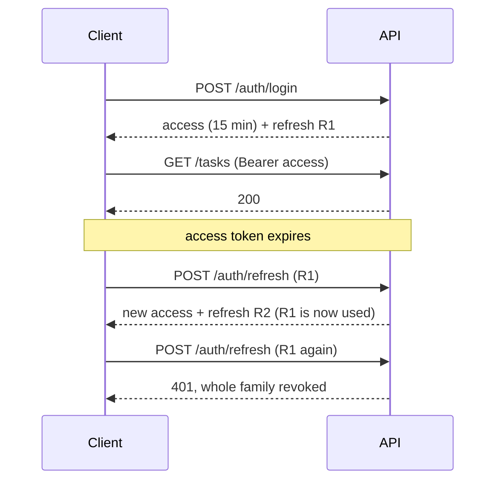
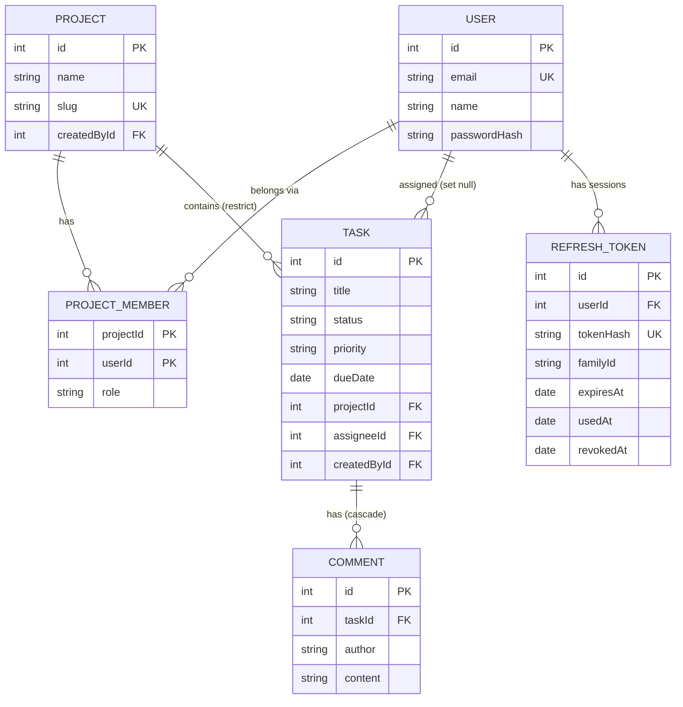

# TaskFlow

A team task-management API built with Node.js, Express, TypeScript, and Prisma.

## Features
- **CLI:** Add, list, start, complete, delete, filter, and export tasks (CSV).
- **HTTP API:** Full CRUD for tasks, projects, and comments, with SQL-powered pagination, sorting, searching, and filtering.
- **Auth:** User registration, login (JWT), refresh tokens (rotation + reuse detection), logout, and **creator-based ownership**.
- **Core:** Repository pattern, Unit of Work for transactions, Zod validation, strict TypeScript, and centralized error handling.
- **Database:** PostgreSQL with Prisma ORM, enforcing referential integrity, cascading deletes, and composite indexes for fast queries.
- **Production Middleware:** Security headers (Helmet), CORS, Request IDs, and body size limits.

## Setup

### Prerequisites
- Node.js 20+
- Docker (for running PostgreSQL)

### Install
```bash
git clone https://github.com/YitbarekYonas/taskflow-api.git
cd taskflow-api
cp .env.example .env
npm install
npm run setup
```

### Verify
```bash
npm run typecheck
```

## Development
```bash
npm run dev     # Run API with auto-restart (http://localhost:3000)
npm run cli -- list  # Run CLI
npm run build   # Build for production
npm start       # Run compiled JS
```

## Database Workflow

| Task | Command |
|---|---|
| Start the database | `npm run db:up` |
| Stop the database | `npm run db:down` |
| Apply migrations and create new ones (dev) | `npm run db:migrate` |
| Apply migrations only (CI, production) | `npm run db:deploy` |
| Rebuild the dev database with sample data | `npm run db:fresh` |
| Add sample data (safe to repeat) | `npm run db:seed` |
| Verify migrations from scratch | `npm run db:check-migrations` |

**Development Seed Credentials:** `sam@example.com` / `dev-password-123` (only available in development, never in production).

## Documentation & Testing

Interactive API docs are available at `http://localhost:3000/docs` when the server is running. You can test every endpoint directly in the browser.

To verify the API against a running server:
```bash
npm run smoke
```
*(The server must be running in another terminal).*


## API Endpoints

**Auth** (public)
| Method | Path | Description | Success |
|--------|------|-------------|---------|
| POST | `/auth/register` | Create an account (Argon2id hashed) | 201 |
| POST | `/auth/login` | Log in and receive access + refresh tokens | 200 |
| POST | `/auth/refresh` | Exchange a refresh token for a new pair | 200 |
| POST | `/auth/logout` | Revoke the refresh token's family | 204 |
| GET | `/auth/me` | Get the logged-in user (requires token) | 200 |
| POST | `/auth/logout-all` | Log out every session (requires token) | 204 |

**Tasks** (login required)
| Method | Path | Description | Success |
|--------|------|-------------|---------|
| GET | `/tasks` | List tasks (see params below) | 200 |
| GET | `/tasks/:id` | Get one task | 200 |
| POST | `/tasks` | Create a task | 201 |
| PATCH | `/tasks/:id` | Update fields (creator only) | 200 |
| DELETE | `/tasks/:id` | Delete a task (creator only) | 204 |

**Projects** (login required)
| Method | Path | Description | Success |
|--------|------|-------------|---------|
| GET | `/projects` | List all projects (includes `taskCount` and `slug`) | 200 |
| GET | `/projects/:id` | Get one project | 200 |
| POST | `/projects` | Create a project | 201 |
| PATCH | `/projects/:id` | Update a project (creator only) | 200 |
| DELETE | `/projects/:id` | Delete a project (fails with 409 if it has tasks, creator only) | 204 |
| GET | `/projects/:id/tasks` | List the tasks of one project | 200 |
| POST | `/projects/:id/duplicate` | Duplicate a project and its tasks (transaction) | 201 |
| POST | `/projects/:id/merge` | Merge this project into another (transaction, creator only) | 200 |

**Comments** (login required)
| Method | Path | Description | Success |
|--------|------|-------------|---------|
| GET | `/tasks/:taskId/comments` | List comments for a task | 200 |
| POST | `/tasks/:taskId/comments` | Create a comment | 201 |
| GET | `/tasks/:taskId/comments/:commentId` | Get one comment | 200 |
| PATCH | `/tasks/:taskId/comments/:commentId` | Update a comment | 200 |
| DELETE | `/tasks/:taskId/comments/:commentId` | Delete a comment | 204 |

### `GET /tasks` Query Parameters
| Param | Values | Default |
|-------|--------|---------|
| `status` | `todo`, `in_progress`, `done` | all |
| `priority` | `low`, `medium`, `high` | all |
| `projectId` | integer (e.g., `1`) | all |
| `search` | text in title | none |
| `sort` | `createdAt`, `dueDate`, `priority`, `title` | `createdAt` |
| `order` | `asc`, `desc` | `asc` |
| `page` / `limit` | integers (limit max 100) | `1` / `10` |

### Sample Response (`GET /tasks`)
```json
{
  "data": [
    { "id": 1, "title": "Write report", "status": "done", "priority": "high", "projectId": 1 }
  ],
  "meta": { "page": 1, "limit": 10, "total": 13, "totalPages": 2, "hasNext": true, "hasPrev": false }
}
```

### Error Response
```json
{
  "error": { "message": "Validation failed", "details": [{ "path": "title", "message": "Required" }] }
}
```
*Status codes: 400 (Bad Input), 401 (Unauthorized), 403 (Forbidden), 404 (Not Found), 409 (Conflict), 413 (Payload Too Large), 500 (Server Error)*

## Authentication & Authorization

### Login & Tokens
Log in to receive a **short-lived access token** (15 min) and a **refresh token** (30 days):

```bash
curl -s -X POST http://localhost:3000/auth/login \
  -H "Content-Type: application/json" \
  -d '{"email":"sam@example.com","password":"dev-password-123"}'
```

Use the access token in the `Authorization: Bearer <token>` header:

```bash
curl http://localhost:3000/tasks \
  -H "Authorization: Bearer <your-token-here>"
```

### Refresh Tokens
Access tokens expire after 15 minutes. Use the refresh token to get a new pair:

```bash
curl -s -X POST http://localhost:3000/auth/refresh \
  -H "Content-Type: application/json" \
  -d '{"refreshToken":"<your-refresh-token>"}'
```

**Important:**
- Each refresh token can be used **only once**.
- A new refresh token is returned on every refresh (rotation).
- If an already-used token is presented, the **entire family** is revoked (reuse detection). Both the thief and the real user will be logged out.

### Logout
```bash
curl -X POST http://localhost:3000/auth/logout \
  -H "Content-Type: application/json" \
  -d '{"refreshToken":"<your-refresh-token>"}'
```

**Note:** Logout revokes the refresh token, but an access token that was already issued stays valid until it expires (15 min). This is the trade-off of stateless tokens.

### Sessions Diagram



*Note: The `/auth/login` and `/auth/register` endpoints never reveal whether an email exists. They always return the same error message and take roughly the same amount of time (thanks to a dummy Argon2 hash).*

## Architecture

```
HTTP request
  → helmet → cors → requestId → logger → json parser
  → route (validate params / query / body)
  → controller (HTTP in, HTTP out)
  → service (business rules)
  → UnitOfWork (transactions) → repository (SQL queries via Prisma)
```

The repository pattern decouples business logic from data storage. Services depend on a `Repository<T>` interface, not a specific implementation. Listing, filtering, sorting, and pagination are handled directly by PostgreSQL using `WHERE`, `ORDER BY`, `LIMIT`, and `OFFSET`. Multi-step operations (like `duplicate` and `merge`) run through a `UnitOfWork`, ensuring they succeed or fail atomically without leaking Prisma details into the services.

## Performance

Moving list queries from JavaScript to SQL drastically reduced response times, especially when handling large datasets. Here are the benchmarks on a seeded database of **50,000 tasks**:

| Query Case | Before (In-Memory) | After (SQL + Indexes) |
|------------|--------------------|-----------------------|
| First page | 180 ms | 6 ms |
| Status + Priority | 220 ms | 4 ms |
| Search | 195 ms | 4 ms |
| Deep page (4999) | 210 ms | 5 ms |

*(Run `npm run db:bench-seed` to seed data, and `npm run bench` to run the benchmark).*

## Configuration
| Variable | Description | Default |
|----------|-------------|---------|
| `PORT` | The port the Express server listens on | `3000` |
| `NODE_ENV` | Environment mode | `development` |
| `DATABASE_URL` | PostgreSQL connection string | (required) |
| `CORS_ORIGIN` | Allowed origins for browser requests | `http://localhost:5173` |
| `LOG_LEVEL` | Logging verbosity (`info` or `debug`) | `info` |
| `JWT_SECRET` | Secret used to sign access tokens (min 32 chars) | (required) |
| `ACCESS_TOKEN_TTL_SECONDS` | Access token lifetime in seconds | `900` (15 min) |
| `REFRESH_TOKEN_TTL_DAYS` | Refresh token lifetime in days | `30` |

## Database



## Production Middleware

- **Helmet:** Sets security-related HTTP headers (e.g., `X-Content-Type-Options`, `Content-Security-Policy`).
- **CORS:** Restricts browser requests to allowed origins (`CORS_ORIGIN` in `.env`).
- **Request IDs:** Each request gets an `X-Request-Id` header, echoed back and included in logs for tracing.
- **Body Limit:** JSON payloads are capped at 100kb to prevent abuse (returns `413 Payload Too Large`).

## Project Structure
```
prisma/
├── schema.prisma         # Database schema
├── seed.ts               # Development seed data
└── migrations/           # SQL migration history

src/
├── app.ts, server.ts, cli.ts
├── auth/                 # Password hashing, JWT utilities, refresh token helpers, policy (Actor, assertOwner)
├── container.ts          # Composition root
├── db.ts                 # Prisma Client instance
├── config.ts, logger.ts, errors.ts, types.ts, utils.ts
├── docs/                 # OpenAPI spec
├── generated/prisma/     # Auto-generated Prisma Client (gitignored)
├── schemas/              # Zod validation
├── repositories/         # Data storage: interface, Prisma impl, UnitOfWork
├── services/             # Business logic: tasks, projects, comments, auth
├── middleware/           # Logger, validation, error handling, request IDs, authenticate
├── controllers/          # HTTP logic
└── routes/               # Express routes
```

## Tech Stack
Node.js, TypeScript, Express 5, PostgreSQL, Prisma, Zod, dotenv, tsx, Helmet, CORS, Swagger UI, Argon2, jose.

## Roadmap
- [x] Week 1 — CLI core
- [x] Week 2 — Express API (CRUD, pagination, filtering, repository pattern, projects, comments, production middleware, OpenAPI docs)
- [x] Week 3 — PostgreSQL & Prisma (Schema, Migrations, ORM integration, Constraints, SQL Pagination, Transactions, Seeding)
- [x] Week 4 — Auth (JWT)
- [x] User registration with Argon2id
- [x] Login and access tokens
- [x] Protect the API (ownership & default deny)
- [x] Refresh tokens and logout

## Known Limitations
1. **Unauthenticated Authors:** Comment authors are supplied by the client as plain strings. This will be replaced by authenticated user IDs in Day 26.
2. **Search Wildcards:** Searching for `%` or `_` returns all tasks because SQL `LIKE` interprets them as wildcards. To fix, escape these characters in the service layer before querying.
3. **No Retries on `P2034`:** We haven't implemented automatic retries for deadlocks yet. If two merges clash, the user must retry manually.
4. **No CI:** We don't have a GitHub Actions pipeline yet. This will be added in Week 7.
5. **Offset pagination is slow on deep pages:** `OFFSET 49980` still walks past 49,980 rows. This will be fixed in Week 5 with keyset pagination.
6. **`ILIKE` search lacks a trigram index:** The search is slow on large tables because it does a full scan. This will be fixed in Week 5.
7. **CSV export loads all rows:** The export uses `findAll()`, which loads the entire table into memory. This will be fixed in Week 5 with a streaming query.
8. **`/health` doesn't check the database:** It returns `ok` even if Postgres is down. This will be fixed in Week 7 with a proper readiness check.
9. **Login is unthrottled:** There's no rate limiting on `/auth/login`, making it vulnerable to brute-force attacks. This will be fixed in Day 27.
10. **Refresh is unthrottled:** There's no rate limiting on `/auth/refresh`, so a flood of requests could exhaust the DB.
11. **No grace window for concurrent refreshes:** Two parallel legitimate refreshes (e.g., a double-click) will kill the family and force a login. Real systems add a short grace window.
12. **Rotation isn't wrapped in one transaction:** If the new token fails to save after the old one is used, the user must log in again.
13. **No device list or session names:** Users can't see "logged in from iPhone" and revoke individual sessions.
14. **Logout doesn't revoke already-issued access tokens:** A stolen access token stays valid for up to 15 minutes after logout.
15. **Legacy ownership:** Tasks and projects created before Day 24 have `createdById: null`, meaning only the CLI can modify them.
