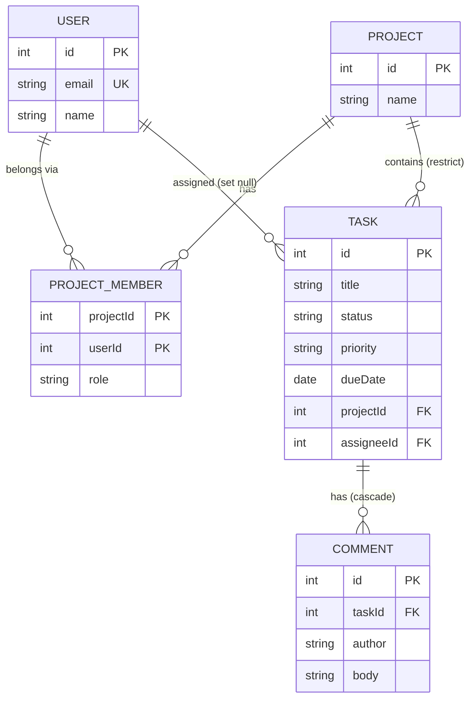

# TaskFlow

A team task-management API built with Node.js, Express, TypeScript, and Prisma.

## Features
- **CLI:** Add, list, start, complete, delete, filter, and export tasks (CSV).
- **HTTP API:** Full CRUD for tasks, projects, and comments, with SQL-powered pagination, sorting, searching, and filtering.
- **Core:** Repository pattern, Zod validation, strict TypeScript, and centralized error handling.
- **Database:** PostgreSQL with Prisma ORM, enforcing referential integrity, cascading deletes, and composite indexes for fast queries.
- **Production Middleware:** Security headers (Helmet), CORS, Request IDs, and body size limits.

## Setup

### Prerequisites
- Node.js 20+
- Docker (for running PostgreSQL)

### Install
```bash
git clone https://github.com/YitbarekYonas/taskflow-api.git
cd taskflow-api
npm install
cp .env.example .env
```

### Database
1. Start the PostgreSQL container:
   ```bash
   docker start taskflow-db
   ```
   *(If you don't have it yet: `docker run --name taskflow-db -e POSTGRES_PASSWORD=postgres -e POSTGRES_DB=taskflow -p 5432:5432 -d postgres:17`)*

2. Run the database migrations:
   ```bash
   npm run db:migrate
   npm run db:generate
   ```

### Verify
```bash
npm run typecheck
```

## Development
```bash
npm run dev     # Run API with auto-restart (http://localhost:3000)
npm run cli -- list  # Run CLI
npm run build   # Build for production
npm start       # Run compiled JS
```

## Documentation & Testing

Interactive API docs are available at `http://localhost:3000/docs` when the server is running. You can test every endpoint directly in the browser.

To verify the API against a running server:
```bash
npm run smoke
```
*(The server must be running in another terminal).*


## API Endpoints

### Tasks
| Method | Path | Description | Success |
|--------|------|-------------|---------|
| GET | `/tasks` | List tasks (see params below) | 200 |
| GET | `/tasks/:id` | Get one task | 200 |
| POST | `/tasks` | Create a task | 201 |
| PATCH | `/tasks/:id` | Update fields | 200 |
| DELETE | `/tasks/:id` | Delete a task | 204 |

### Projects
| Method | Path | Description | Success |
|--------|------|-------------|---------|
| GET | `/projects` | List all projects (includes `taskCount`) | 200 |
| GET | `/projects/:id` | Get one project | 200 |
| POST | `/projects` | Create a project | 201 |
| PATCH | `/projects/:id` | Update a project | 200 |
| DELETE | `/projects/:id` | Delete a project (fails with 409 if it has tasks) | 204 |
| GET | `/projects/:id/tasks` | List the tasks of one project | 200 |

### Comments
| Method | Path | Description | Success |
|--------|------|-------------|---------|
| GET | `/tasks/:taskId/comments` | List comments for a task | 200 |
| POST | `/tasks/:taskId/comments` | Create a comment | 201 |
| GET | `/tasks/:taskId/comments/:commentId` | Get one comment | 200 |
| PATCH | `/tasks/:taskId/comments/:commentId` | Update a comment | 200 |
| DELETE | `/tasks/:taskId/comments/:commentId` | Delete a comment | 204 |

### `GET /tasks` Query Parameters
| Param | Values | Default |
|-------|--------|---------|
| `status` | `todo`, `in_progress`, `done` | all |
| `priority` | `low`, `medium`, `high` | all |
| `projectId` | integer (e.g., `1`) | all |
| `search` | text in title | none |
| `sort` | `createdAt`, `dueDate`, `priority`, `title` | `createdAt` |
| `order` | `asc`, `desc` | `asc` |
| `page` / `limit` | integers (limit max 100) | `1` / `10` |

### Sample Response (`GET /tasks`)
```json
{
  "data": [
    { "id": 1, "title": "Write report", "status": "done", "priority": "high", "projectId": 1 }
  ],
  "meta": { "page": 1, "limit": 10, "total": 13, "totalPages": 2, "hasNext": true, "hasPrev": false }
}
```

### Error Response
```json
{
  "error": { "message": "Validation failed", "details": [{ "path": "title", "message": "Required" }] }
}
```
*Status codes: 400 (Bad Input), 404 (Not Found), 409 (Conflict), 413 (Payload Too Large), 500 (Server Error)*

## Architecture

```
HTTP request
  → helmet → cors → requestId → logger → json parser
  → route (validate params / query / body)
  → controller (HTTP in, HTTP out)
  → service (business rules)
  → repository (SQL queries via Prisma)
```

The repository pattern decouples business logic from data storage. Services depend on a `Repository<T>` interface, not a specific implementation. Listing, filtering, sorting, and pagination are handled directly by PostgreSQL using `WHERE`, `ORDER BY`, `LIMIT`, and `OFFSET`.

## Performance

Moving list queries from JavaScript to SQL drastically reduced response times, especially when handling large datasets. Here are the benchmarks on a seeded database of **50,000 tasks**:

| Query Case | Before (In-Memory) | After (SQL + Indexes) |
|------------|--------------------|-----------------------|
| First page | 180 ms | 6 ms |
| Status + Priority | 220 ms | 4 ms |
| Search | 195 ms | 4 ms |
| Deep page (4999) | 210 ms | 5 ms |

*(Run `npm run db:bench-seed` to seed data, and `npm run bench` to run the benchmark).*

## Configuration
| Variable | Description | Default |
|----------|-------------|---------|
| `PORT` | The port the Express server listens on | `3000` |
| `NODE_ENV` | Environment mode | `development` |
| `DATABASE_URL` | PostgreSQL connection string | (required) |
| `CORS_ORIGIN` | Allowed origins for browser requests | `http://localhost:5173` |

## Database



## Production Middleware

- **Helmet:** Sets security-related HTTP headers (e.g., `X-Content-Type-Options`, `Content-Security-Policy`).
- **CORS:** Restricts browser requests to allowed origins (`CORS_ORIGIN` in `.env`).
- **Request IDs:** Each request gets an `X-Request-Id` header, echoed back and included in logs for tracing.
- **Body Limit:** JSON payloads are capped at 100kb to prevent abuse (returns `413 Payload Too Large`).

## Project Structure
```
prisma/
├── schema.prisma         # Database schema
└── migrations/           # SQL migration history

src/
├── app.ts, server.ts, cli.ts
├── container.ts          # Composition root
├── db.ts                 # Prisma Client instance
├── config.ts, logger.ts, errors.ts, types.ts, utils.ts
├── docs/                 # OpenAPI spec
├── generated/prisma/     # Auto-generated Prisma Client (gitignored)
├── schemas/              # Zod validation
├── repositories/         # Data storage: interface, Prisma impl
├── services/             # Business logic: tasks, projects, comments, queries
├── middleware/           # Logger, validation, error handling, request IDs
├── controllers/          # HTTP logic
└── routes/               # Express routes
```

## Tech Stack
Node.js, TypeScript, Express 5, PostgreSQL, Prisma, Zod, dotenv, tsx, Helmet, CORS, Swagger UI.

## Roadmap
- [x] Week 1 — CLI core
- [x] Week 2 — Express API (CRUD, pagination, filtering, repository pattern, projects, comments, production middleware, OpenAPI docs)
- [x] Week 3 — PostgreSQL & Prisma (Schema, Migrations, ORM integration, Constraints, SQL Pagination)
- [ ] Week 4 — Auth (JWT)

## Known Limitations
1. **Unauthenticated Authors:** Comment authors are supplied by the client as plain strings. This will be replaced by authenticated user IDs in Week 4.
2. **Search Wildcards:** Searching for `%` or `_` returns all tasks because SQL `LIKE` interprets them as wildcards. To fix, escape these characters in the service layer before querying.
